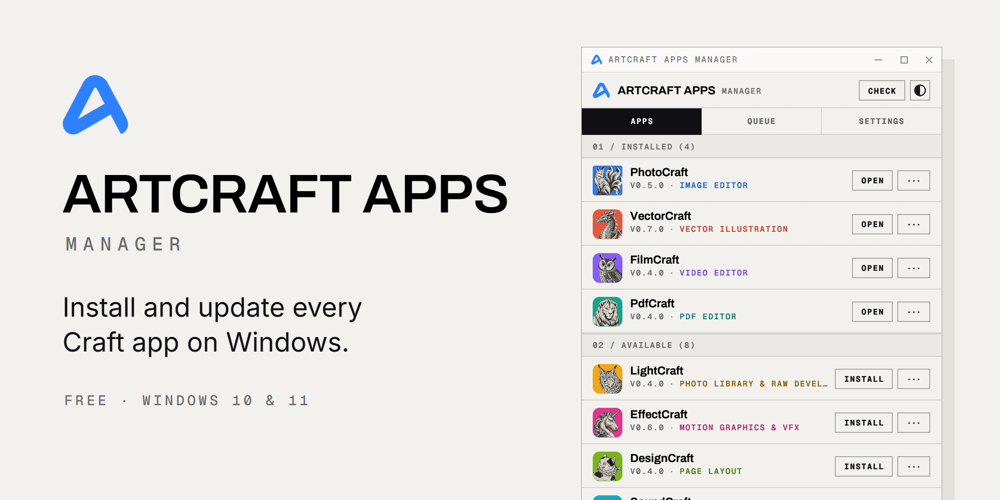
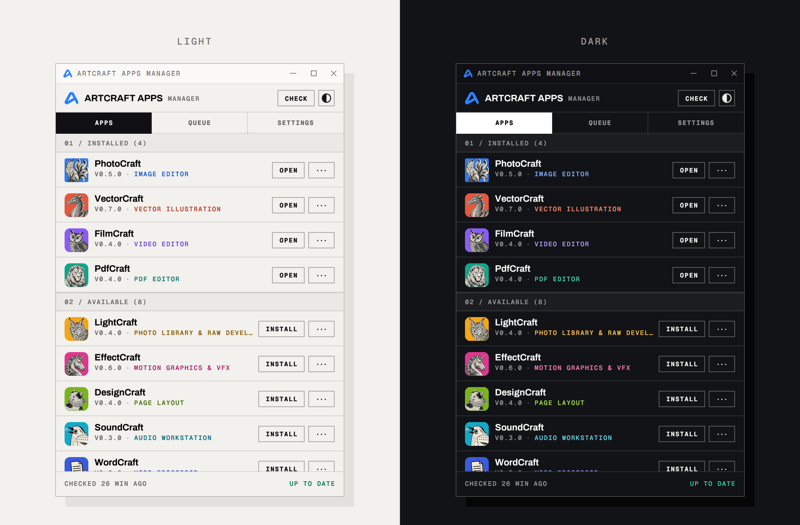

<p align="center">
  <a href="https://artcraftappsmanager.web.app/">
    <picture>
      <source media="(prefers-color-scheme: dark)" srcset="https://raw.githubusercontent.com/GeorgeMilroy/Craft-Apps-Manager/main/docs/images/banner-dark.png">
      
    </picture>
  </a>
</p>

<p align="center">
  <a href="https://artcraftappsmanager.web.app/download"></a>
</p>

<p align="center">
  <a href="https://artcraftappsmanager.web.app/">Download page</a> &nbsp;·&nbsp;
  <a href="https://artcraftappsmanager.web.app/download/x86">32-bit version</a> &nbsp;·&nbsp;
  <a href="https://github.com/GeorgeMilroy/Craft-Apps-Manager/releases">Releases</a>
</p>

<p align="center">
  
  
  
  
</p>

ArtCraft Apps Manager is a free Windows app that installs PhotoCraft,
VectorCraft, FilmCraft and the rest of the Craft apps from their official
releases at [github.com/storytold](https://github.com/storytold), then tells
you when a new version is out.

It's an independent project, not affiliated with ArtCraft. The apps are
developed and supported by their creators at
[getartcraft.com](https://getartcraft.com/).

## Features

- **Every app in one list.** Every Craft app with a Windows build, with the
  version you have and the latest release.
- **Install and update in one click.** Apps install from their GitHub
  releases. Downloads go through a queue, one at a time, and the next
  download starts while the previous app is still installing.
- **Verified downloads.** Each installer is checked against its published
  SHA-256 before it runs.
- **Update notifications.** Checks for new releases every 4 hours by default,
  with no GitHub account, and shows a Windows notification when there's an
  update.
- **Official installers.** Apps install with their own MSIs into Program
  Files, with Start menu entries, and uninstall from Windows Settings like
  any other app.
- **Stays out of the way.** Closing the window keeps it in the system tray;
  quit from the tray menu or from Settings. Starting at sign-in is optional
  and off by default. When on, it starts minimized in the tray.

## Light and dark

<p align="center">
  
</p>

The window is compact (460 × 660 by default) and follows the design of
[getartcraft.com](https://getartcraft.com/apps): the site's light and dark
colours, square corners, hairline rules, Archivo headings, Inter text and
uppercase Geist Mono labels. Settings has a theme switch (System, Light or
Dark), and the half-filled circle in the top bar flips between light and
dark.

The manager's logo is the ArtCraft "A" mark, taken from the ArtCraft app's
own icon (`assets\logo.ico` and `assets\logo.png`). It's used for the window,
the tray, notifications, the exe and the installer.

Each app shows its own icon and colours. The icons are the ones on
getartcraft.com; for apps the site doesn't list yet (SoundCraft, WordCraft,
GridCraft, DeckCraft, CADCraft) they come from the app's repository. They're
embedded in the exe, in `assets\app-icons`, so they show offline. Apps
discovered later get their icon from their repository.

The fonts in `assets\fonts` are Inter, Archivo and Geist Mono, under the SIL
Open Font License (licence texts alongside).

## The apps it installs

<table>
  <tr>
    <td align="center" valign="top" width="25%">
      <a href="https://github.com/storytold/photocraft"><br><b>PhotoCraft</b></a><br>
      <sub>Image editing<br>Photoshop-style</sub>
    </td>
    <td align="center" valign="top" width="25%">
      <a href="https://github.com/storytold/lightcraft"><br><b>LightCraft</b></a><br>
      <sub>Photo library &amp; RAW<br>Lightroom-style</sub>
    </td>
    <td align="center" valign="top" width="25%">
      <a href="https://github.com/storytold/vectorcraft"><br><b>VectorCraft</b></a><br>
      <sub>Vector illustration<br>Illustrator-style</sub>
    </td>
    <td align="center" valign="top" width="25%">
      <a href="https://github.com/storytold/designcraft"><br><b>DesignCraft</b></a><br>
      <sub>Page layout<br>InDesign-style</sub>
    </td>
  </tr>
  <tr>
    <td align="center" valign="top" width="25%">
      <a href="https://github.com/storytold/filmcraft"><br><b>FilmCraft</b></a><br>
      <sub>Video editing<br>Premiere Pro-style</sub>
    </td>
    <td align="center" valign="top" width="25%">
      <a href="https://github.com/storytold/effectcraft"><br><b>EffectCraft</b></a><br>
      <sub>Motion graphics &amp; VFX<br>After Effects-style</sub>
    </td>
    <td align="center" valign="top" width="25%">
      <a href="https://github.com/storytold/soundcraft"><br><b>SoundCraft</b></a><br>
      <sub>Audio recording &amp; mixing<br>Pro Tools-style</sub>
    </td>
    <td align="center" valign="top" width="25%">
      <a href="https://github.com/storytold/pdfcraft"><br><b>PdfCraft</b></a><br>
      <sub>PDF viewing &amp; editing<br>Acrobat-style. Formerly PrintCraft</sub>
    </td>
  </tr>
  <tr>
    <td align="center" valign="top" width="25%">
      <a href="https://github.com/storytold/wordcraft"><br><b>WordCraft</b></a><br>
      <sub>Word processing<br>Word-style</sub>
    </td>
    <td align="center" valign="top" width="25%">
      <a href="https://github.com/storytold/gridcraft"><br><b>GridCraft</b></a><br>
      <sub>Spreadsheets<br>Excel-style</sub>
    </td>
    <td align="center" valign="top" width="25%">
      <a href="https://github.com/storytold/deckcraft"><br><b>DeckCraft</b></a><br>
      <sub>Presentations<br>PowerPoint-style</sub>
    </td>
    <td align="center" valign="top" width="25%">
      <a href="https://github.com/storytold/cadcraft"><br><b>CADCraft</b></a><br>
      <sub>CAD &amp; drafting<br>AutoCAD-style</sub>
    </td>
  </tr>
</table>

ArtCraft itself isn't offered: its logo is the manager's logo. The other
storytold repositories don't publish Windows builds: libraries, services,
test data, forks and older experiments. If a new `*craft` repository starts
publishing Windows releases, the manager adds it automatically.

## Install

| Your PC | Installer |
| --- | --- |
| 64-bit Windows 10 or 11 (almost every PC) | [Download the 64-bit installer](https://artcraftappsmanager.web.app/download) |
| 32-bit Windows 10 | [Download the 32-bit installer](https://artcraftappsmanager.web.app/download/x86) |

1. Download the installer.
2. Open it, follow the setup wizard, and allow the change when Windows asks.
   It installs for everyone who uses the PC.
3. Open ArtCraft Apps Manager from the Start menu and press **Install** next
   to the apps you want.

> [!TIP]
> If Windows SmartScreen says it protected your PC, choose **More info**,
> then **Run anyway**. Windows shows this for installers it hasn't seen many
> downloads of yet.

To check which Windows you have, open Settings > System > About and look at
*System type*. Windows 11 is always 64-bit.

### More about the installer

`ArtCraftAppsManager-<version>-x64.msi` installs the manager for all users in
`C:\Program Files\ArtCraft Apps Manager`, with a Start menu shortcut. That's
for 64-bit Windows. For 32-bit Windows there's
`ArtCraftAppsManager-<version>-x86.msi`, which won't install on 64-bit Windows.
Either one installs the right build of each Craft app for the PC. The
setup wizard has a Welcome page, a Ready to install page and a Finish page
with a *Launch ArtCraft Apps Manager* box, ticked by default. The publisher is
ME Core Labs (mecorelabs.com). Installing a newer MSI upgrades it in place.
The installer closes a running copy first, so no restart is needed.

To uninstall, use *Uninstall ArtCraft Apps Manager* in the Start menu, or
Windows Settings > Apps. Either way it also deletes the manager's data (see
[Where things are kept](#where-things-are-kept)). The Craft apps it
installed stay installed.

Versions before 0.4 were called Craft Apps Manager. The 0.4 installer
replaces them like any other upgrade.

### How the Craft apps are installed

Every app installs from its official MSI into `C:\Program Files\<App>`, for
all users, with a Start menu entry. Windows asks for admin permission each
time. The manager runs `msiexec /passive`, so you see a progress bar but no
wizard. Apps you installed yourself before using the manager are detected
from Windows' list of installed apps.

## Where things are kept

Program Files is read-only without admin rights, so the manager's data lives
in `C:\ProgramData\ArtCraftAppsManager`, shared by everyone who uses the PC. The
installer gives the Users group write access to it.

| File or folder | Contents |
| --- | --- |
| `settings.json` | Settings |
| `state.json` | Cached release data, and which updates have been announced |
| `downloads\` | Installers. Deleted after installing unless *Keep downloaded installers* is on |
| `logs\` | Windows Installer logs, one per install |

Uninstalling the manager deletes this folder, but upgrading to a newer
version keeps it. Older versions kept their data elsewhere, and the
manager moves it across on first start, then removes the old folder:
- 0.1 used `%LOCALAPPDATA%\CraftAppsManager`;
- 0.2 and 0.3 used `C:\ProgramData\CraftAppsManager`.

Starting at sign-in is per Windows user. It uses the
`HKCU\Software\Microsoft\Windows\CurrentVersion\Run` value
`ArtCraftAppsManager`. Versions before 0.4 used `CraftAppsManager`. The
manager replaces that entry the first time it runs, so if you had it
starting at sign-in, open it once after upgrading.

## GitHub API limits

Release information comes straight from the GitHub API, without signing in.
GitHub allows 60 unauthenticated requests an hour per IP address. A check
uses one request per app (12 today), and looking for new apps adds one a
day. Restarting the app within 30 minutes of a check reuses the cached
results instead of checking again. Normal use stays well within the limit.
If it's ever used up (for example by other tools on the same network), the
app shows when it resets, keeps showing the last results, and checks again
automatically.
## Building

You need Rust (via [rustup](https://rustup.rs)) and the Visual Studio C++
build tools.

```
cargo build --release
```

This builds `target\release\artcraft-apps-manager.exe`, which also runs without
being installed. Run `cargo test` for the unit tests.

To build the installers, first install the WiX v5 .NET tool and its
extensions, and Rust's 32-bit target (one-time):

```
dotnet tool install --global wix --version 5.0.2
wix extension add -g WixToolset.Util.wixext/5.0.2
wix extension add -g WixToolset.UI.wixext/5.0.2
rustup target add i686-pc-windows-msvc
```

Then run `installer\build-installer.ps1`. It builds the 64-bit and 32-bit
release exes and writes `target\installer\ArtCraftAppsManager-<version>-x64.msi`
and `-x86.msi`. Add `-Arch x64` or `-Arch x86` to build only one. WiX is pinned
to v5, which is MS-RL licensed. WiX v6 and later require accepting the "Open
Source Maintenance Fee" agreement, which can mean fees for commercial users.

### npm scripts

`package.json` has shortcuts for these steps, if you have Node.js. It has no
dependencies, so there's nothing to `npm install`. The version is still the
one in `Cargo.toml`.

| Command | What it does |
| --- | --- |
| `npm start` | Runs the app (`cargo run`) |
| `npm test` | Runs the unit tests |
| `npm run build:app` | Builds the release exe |
| `npm run build:installer` | Builds both installers. `build:installer:x64` or `build:installer:x86` builds one |
| `npm run build:installer:mac` | On a Mac, builds the macOS disk image (see below) |
| `npm run build:site` | Builds the download page into `site\public` |
| `npm run build` | Builds both installers, then the download page |
| `npm run preview` | Builds the download page and serves it at http://127.0.0.1:5000 with the Firebase Hosting emulator. It works offline, without signing in, but doesn't apply the `/download` redirects |
| `npm run deploy` | Builds the download page and publishes it (see below) |
| `npm run release` | Builds both installers, then deploys |

Arguments after `--` go to the PowerShell script, for example
`npm run deploy -- -KeyFile <path to the service account key>`.

### macOS

The Mac version is built from the same code. It installs each app's
universal disk image (`*-macos-universal.dmg`) by copying the app into
/Applications, and macOS asks for an administrator's password if you can't
change that folder. Uninstalling moves the app to the Trash. The manager
keeps its data in `~/Library/Application Support/ArtCraftAppsManager` and
starts at login with a LaunchAgent. When its window is closed it stays in
the menu bar, and leaves the Dock until it's opened again.

To build it, on a Mac with Xcode's command line tools:

```
rustup target add aarch64-apple-darwin x86_64-apple-darwin
bash installer/build-macos.sh
```

That writes `target/installer/ArtCraftAppsManager-<version>-macos-universal.dmg`,
for Apple silicon and Intel Macs running macOS 11 or later. The app is
signed ad hoc, not with an Apple Developer ID, so macOS blocks it the first
time it's opened. To allow it, go to System Settings > Privacy & Security
and choose *Open Anyway*.

### GitHub Actions

`.github/workflows/build.yml` builds and tests the Mac and Windows versions
on every push to `main` and every pull request, on GitHub's Mac and Windows
machines. Each run keeps the DMG and both MSIs as downloadable artifacts.
Pushing a version tag, such as `v0.4.1`, also creates a draft release with
them attached, to check and publish.

## Download page

`site\` is the download page. Firebase Hosting serves the same content from
seven sites in the `getartcraftupdater` project. The main address, which
search engines and shared links use, is artcraftappsmanager.web.app. The
others are:
- artcraftapps.web.app
- artcraftappsupdater.web.app
- craftappsmanager.web.app
- craftappsupdater.web.app
- getartcraftmanager.web.app
- getartcraftupdater.web.app

`/download` on each one redirects to the newest 64-bit installer and
`/download/x86` to the 32-bit one. `/latest.json` gives the version, and
each installer's address, size and SHA-256.

To publish a new version, build the installers, then run:

```
site\build.ps1 -Deploy -KeyFile <path to the service account key>
```

The key is a Firebase service account key for the `getartcraftupdater`
project. Keep it outside this folder. Without `-KeyFile`, the deploy uses the
account the Firebase CLI is signed in with, which needs access to the
project.

That copies both installers into `site\public`, fills in their version,
sizes and checksums, and deploys to all seven sites. Without `-Deploy` it only
builds. The site list and the Hosting settings they share are in
`site\hosting.json`; the build turns them into `site\firebase.json`, with
one entry per site.

The page uses Firebase Analytics. All seven sites report to the same Google
Analytics stream (`G-WPVYWX5H5V`, the "ArtCraft Apps Manager" web app), set
in `site\src\js\config.js`. Every event, page views included, has a `site`
parameter naming the site it came from; GA's built-in Hostname dimension
shows the same. Local previews don't send anything.

Download button clicks are logged as a `download_click` event, with these
parameters:
- `placement`: which button, `header`, `hero`, `details` or `footer`, or
  for the 32-bit installer's links, `hero-x86`, `details-x86` or `faq-x86`;
- `version`;
- `file_name`.

Ad blockers stop some of these events, so treat the counts as a lower bound.

## About

ArtCraft Apps Manager is made by [ME Core Labs](https://mecorelabs.com). It
isn't made by, affiliated with or endorsed by ArtCraft or the developers of
the Craft apps. The apps are created, published and supported by their
developers at [getartcraft.com](https://getartcraft.com/); for questions
about an app, please visit getartcraft.com.

ArtCraft, the Craft app names and logos, and the other product names here
are trademarks of their respective owners.
